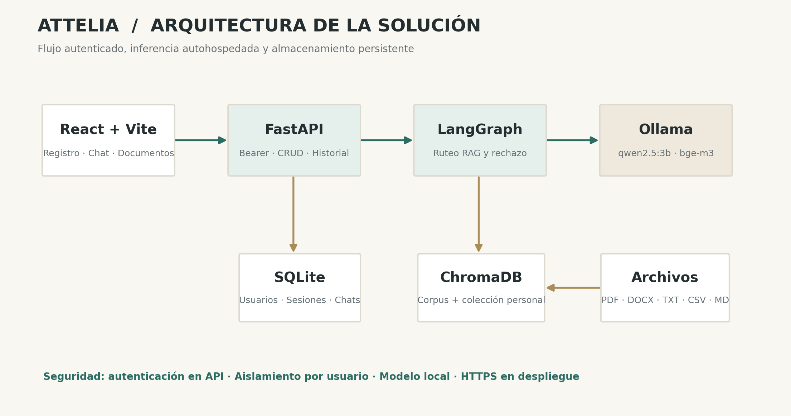
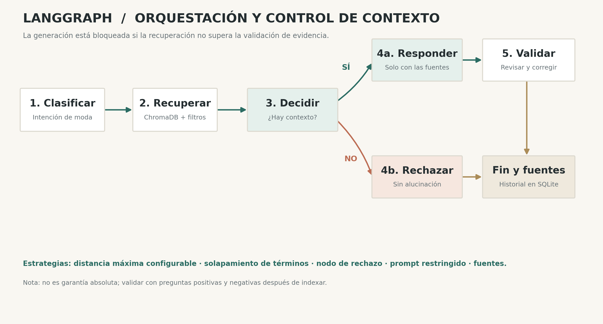

# AtteliA · Asesora inteligente de moda con RAG

Proyecto académico de **Armario IA**. Aplicación web con **React, FastAPI, LangChain, LangGraph, Ollama y ChromaDB**. Responde preguntas de moda a partir de un corpus documental y de archivos cargados por el usuario autenticado.

> **Estado verificado al 18 de octubre de 2026:** funcionamiento local comprobado en Ubuntu/WSL con Ollama, recuperación de los volúmenes de moda, rechazo explícito de preguntas sin evidencia y prueba incremental con un TXT nuevo (Aurora-47) tras corregir una respuesta inicial no fiel al documento. Capturas reales en `docs/evidencias/` y anexos E–F del documento técnico. La publicación en GitHub y el despliegue público **siguen pendientes**; no se incluyen URL inventadas.

## Arquitectura





- Frontend React 18 + Vite; pantalla de login, chat, historial y documentos.
- API FastAPI; contraseñas con scrypt + salt, tokens aleatorios almacenados como SHA-256 en SQLite, vigencia de siete días.
- LangGraph: clasificar → recuperar → **validar suficiencia de contexto** → responder / rechazar → revisar → corregir si aplica.
- LangChain + `langchain-ollama` + Ollama `qwen2.5:3b`; `bge-m3` para embeddings.
- Chroma persistente: colección base `attelia_conocimiento` + colección aislada `attelia_usuario_ID` por usuario.
- Documentos admitidos: **PDF, DOCX, TXT, MD y CSV**, 10 MB por defecto. PDF escaneado sin capa de texto no funciona sin OCR previo.

## Estructura

```text
backend/app/main.py                 API/autenticación/historial/documentos
backend/app/agents/graph.py         grafo LangGraph
backend/app/vectorstore/rag.py      búsqueda e indexación Chroma
backend/app/services/documentos.py  carga, extracción y borrado de vectores
backend/tests/                      pruebas automatizadas
frontend/src/App.jsx                aplicación React
frontend/src/style.css              estilos
docs/preparados/volumen_*.txt       corpus inicial (6 volúmenes)
docs/documento-tecnico.pdf          memoria técnica
docs/presentacion.pdf               apoyo a sustentación
docs/guion-sustentacion.md          guion y demo
docker-compose.yml                  backend + frontend + Ollama + Caddy
.env.example                        ejemplo sin secretos
```

## Instalación local (Ubuntu / WSL)

**Requisitos:** Python 3.11+, Node.js 20+, npm, Ollama y memoria suficiente (recomendado 8 GB o más; más memoria mejora la velocidad). Trabaja desde la raíz del repositorio.

1. Instala Ollama en Ubuntu siguiendo https://ollama.com/download y comprueba `ollama --version`.
2. Ejecuta Ollama (en una terminal: `ollama serve`; si ya corre como servicio, no inicies un segundo servidor) y descarga los modelos:

```bash
ollama pull qwen2.5:3b
ollama pull bge-m3
ollama list
```

3. En una nueva terminal, prepara Python:

```bash
cd backend
python3 -m venv .venv
source .venv/bin/activate
pip install -r requirements.txt
cd ..
```

4. Indexa los seis volúmenes de moda una vez (es normal que tarde varios minutos):

```bash
export PYTHONPATH=backend
python -m app.vectorstore.rag
```

5. Ejecuta la API:

```bash
PYTHONPATH=backend uvicorn app.main:app --reload --host 127.0.0.1 --port 8000
```

6. Desde otra terminal inicia el frontend:

```bash
cd frontend
cp .env.example .env.local
npm ci
npm run dev
```

Abre `http://localhost:5173`, regístrate y prueba el chat. Los archivos SQLite y Chroma se crean en `data/` (persistentes, excluidos de Git).

## Pruebas

```bash
cd backend
source .venv/bin/activate
cd ..
./scripts/verificar_backend.sh
```

Las pruebas HTTP usan una implementación simulada de la indexación para validar la API y permisos **sin necesitar Ollama**. `test_graph.py` verifica que el grafo rechaza consultas sin contexto, sin invocar el generador. La **prueba funcional real** de Ollama/embeddings se realiza con la lista de verificación de `docs/pruebas-manuales.md`.

## API (seguridad)

Las rutas `register`/`login` no necesitan token por su propia función. **Las demás rutas de aplicación requieren** `Authorization: Bearer TOKEN`. `/docs` y `/openapi.json` públicos se deshabilitan.

| Método | Ruta | Función |
|---|---|---|
| POST | `/api/auth/register` | crear usuario y sesión |
| POST | `/api/auth/login` | iniciar sesión |
| GET | `/api/auth/me` | perfil autenticado |
| POST | `/api/auth/logout` | revocar token actual |
| POST | `/api/chat` | pregunta fundamentada y guardada |
| GET | `/api/chat/history` | historial privado |
| DELETE | `/api/chat/history` | vaciar historial privado |
| GET | `/api/documents` | listar documentos propios |
| POST | `/api/documents` | cargar archivo multipart, campo `archivo` |
| DELETE | `/api/documents/{id}` | borrar archivo y vectores propios |
| GET | `/api/health` | estado (requiere token) |

Ejemplo: `curl -H "Authorization: Bearer TU_TOKEN" https://tu-dominio.com/api/documents`.

## Antialucinaciones

1. Búsqueda con distancia Chroma máxima configurable `RAG_MAX_DISTANCE` y coincidencia de términos de consulta en contexto.
2. Nodo condicional **`decidir_contexto`** en LangGraph que desvía a `rechazar` antes de generar si no hay evidencia suficiente.
3. Prompt que prohíbe conocimientos generales fuera del contexto, además de un validador y fuentes visibles.
4. Cuando falta evidencia, respuesta literal: **No tengo suficiente información en mi base de conocimiento para responder esa pregunta.**

**Límite de validez:** ninguna heurística elimina al 100% las alucinaciones. Ajusta el umbral tras ensayar consultas positivas y negativas y compara las fuentes con la respuesta. Un filtro demasiado estricto puede rechazar respuestas válidas.

## Despliegue con Docker Compose en un VPS

El modelo **no puede residir solo en el navegador o Vercel**. Debe ejecutarse en un servidor que aloje Ollama. Esta solución distribuye frontend y API mediante Caddy HTTPS y deja Ollama en red interna. Recomendación preliminar: VPS Linux con **al menos 8 GB de RAM**, 4 vCPU, disco 25+ GB y puertos 80/443 públicos. Requisitos reales varían con la carga.

1. Crea repositorio GitHub y sube este código (sin `data/`, credenciales ni `node_modules`).
2. Provisiona un VPS Linux con Docker Engine + Compose plugin y asigna un **dominio** con DNS A apuntando a su IP.
3. Clona el repositorio. Ejecuta `cp .env.example .env` y define `SITE_DOMAIN=dominio-real.com`.
4. Verifica que Caddy pueda acceder públicamente a los puertos TCP 80 y 443.
5. Ejecuta:

```bash
docker compose up -d --build
docker compose logs -f ollama-init
# Cuando se hayan descargado qwen2.5:3b y bge-m3:
docker compose exec backend python -m app.vectorstore.rag
```

6. Abre `https://dominio-real.com`, regístrate, carga un documento y realiza preguntas. En el informe sustituye las URL pendientes por URL reales y pega capturas propias.
7. Para inspección: `docker compose logs -f backend`, `docker compose logs -f gateway`; para reiniciar: `docker compose restart backend`.

**Precaución:** no expongas directamente el puerto 11434 de Ollama, ni copies el archivo `.env` con secretos a GitHub. Usa HTTPS porque la API recibe credenciales. Los volúmenes persistentes están en `./data` y `ollama_models`.

## Problemas conocidos y límites

- El indexado inicial **no está incluido como vectores listos** en el ZIP ligero; el conjunto de seis volúmenes sí. Hay que ejecutar `python -m app.vectorstore.rag` para reconstruirlo.
- PDFs escaneados requieren OCR, actualmente no incluido.
- No hay procesamiento asíncrono en segundo plano: el endpoint responde cuando acaba la indexación.
- Chroma y SQLite en volumen local están pensados para una instancia, no alta concurrencia multinodo.
- No hay recuperación automática de contraseña, rate limiting distribuido ni panel de administración.
- Un índice semántico puede devolver fragmentos insuficientes: es obligatorio demostrar rechazos. Para calibrar distancias reales: `PYTHONPATH=backend python scripts/diagnosticar_rag.py`.
- La publicación en GitHub, despliegue real y capturas dependen de credenciales y ejecución del equipo.

## Licencias y fuentes

Corpus: seis archivos preparados en `docs/preparados/`; fuentes y atribuciones en `docs/fuentes.md`. El dataset Polyvore y su lógica experimental se mantienen como referencia opcional, **pero no forman parte del flujo RAG evaluado** ni del ZIP optimizado. Revisar licencias antes de redistribuir datos externos.

## Documentos de entrega

`docs/documento-tecnico.pdf`, `docs/presentacion.pdf`, `docs/guion-sustentacion.md`, `docs/pruebas-manuales.md` y los dos diagramas PNG. Completar nombre/integrantes, URLs y evidencias de ejecución antes de entregar.
